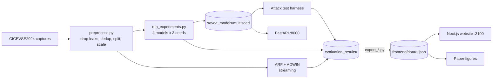

<div align="center">
  
  
  <p align="center">
    <b>A leakage-corrected intrusion detection system for Electric Vehicle Charging Station (EVCS) networks: audit, benchmarks, and a working system.</b>
  </p>

  <p align="center">
    <a href="https://github.com/Mukta01/EVNet_Sentinel/stargazers"></a>
    <a href="https://github.com/Mukta01/EVNet_Sentinel/network/members"></a>
    <a href="https://github.com/Mukta01/EVNet_Sentinel/issues"></a>
    
    
  </p>
</div>

---

## ⚡ Overview

EVNet Sentinel reproduces and **audits** Makhmudov et al. (2025), an online intrusion detector (Adaptive Random Forest + ADWIN) for EV charging networks, on the CICEVSE2024 dataset. It then rebuilds the detector correctly and wraps it in a usable system.

| | |
|---|---|
| **The finding** | The published 98.4% accuracy is mostly a **data leak**: one capture-timestamp column alone scores **99.76%**, and ADWIN's drift alarms fall on the joins between capture files (42 of 43, p < 0.0005). |
| **Corrected result** | Leak-free **macro-F1 0.558 ± 0.008** (Random Forest, 3 seeds). Volumetric floods are near-perfectly separable (F1 ≥ 0.999); the six nmap scan types are not, and mutual information shows that limit is in the flow features, not the models. |
| **Operationally** | No attack passes as normal traffic. Random Forest names attacks best with the fewest false alarms (2%). A confidence gate turns most wrong scan names into correct "reconnaissance" alerts. |

## 🚀 Features

- 🔍 **Leakage audit**: five reproducible findings (timestamp leak, dropped `dst_port`, stream-order autocorrelation, drift on file seams, `src_port` fingerprint).
- 🧠 **Corrected benchmarks**: Random Forest, Decision Tree, Logistic Regression, SVM and ARF + ADWIN on **15 classes**, mean ± std over seeds 42 / 1337 / 2024, macro-F1 as the headline metric.
- 🎯 **Per-attack test harness**: every attack × every model in 30 batches of 50 unseen flows, scored as detected / right category / named exactly, with regression gates (`make attack-test`).
- 🛡️ **Simulated containment**: site threat level (Safe → Elevated → Network not safe) and an operator-approved quarantine of the attacking device. Sentinel itself stays a passive mirror-port IDS.
- 📊 **Web front end** (Next.js): interactive landing page, attack simulation console and results dashboard, all built from exported results so every number is reproducible.
- ⚙️ **Prediction API** (FastAPI): classifies one flow per request with any of the corrected models.

## 🏗️ Architecture



The website does **not** call the API; it reads the exported JSON. Animated, source-linked versions of this pipeline and of one `POST /predict` call are in [`docs/diagrams/`](./docs/diagrams/) (`make diagrams`).

## ▶️ Quick start

```bash
make setup && (cd frontend && npm install)   # once
make web        # website  -> http://localhost:3100
make api        # API      -> http://localhost:8000   (needs locally trained models)
make diagrams   # diagrams -> http://localhost:8765
make test       # 71 automated tests
```

Full instructions, including how to stop everything and how to share a public link with ngrok: [**docs/RUNNING.md**](./docs/RUNNING.md).

| Page | What it shows |
|---|---|
| `/` | *Beat the Sentinel* (drag an attack onto a station), *Tune the detector*, and a scroll story of the testbed and its place in Mumbai |
| `/simulation` | Launch any of the 14 attacks from the device that really sent it; watch the mirror-port tap, incident log, site threat level and quarantine |
| `/dashboard` | **Findings** (leak evidence, confusion explorer, separability, model table, drift), **Attack insights** (per-attack results and response guidance), **Live inference** |
| `/docs` | Method at a glance and component architecture |

## 📁 Directory structure

| Path | Contents |
|---|---|
| `src/data_prep/` | `preprocess.py`: the corrected (leak-free) pipeline |
| `src/models/` | Training scripts and notebooks per model (`random_forest`, `decision_tree`, `log_reg`, `svm`, `arfadwin`) |
| `src/evaluation/` | Multi-seed experiments, attack test harness, exporters for the website and paper figures |
| `src/reproduction/` | Scripts that reproduce each leakage finding and the attack routes |
| `src/response/` | Containment policy (threat level and quarantine rules) |
| `src/api/` | FastAPI prediction service |
| `frontend/` | Next.js website; `frontend/data/` holds the exported results it displays |
| `evaluation_results/` | Every reported number, labelled current / evidence / historical ([README](./evaluation_results/README.md)) |
| `tests/` | pytest suite |
| `docs/` | Documentation, research papers, figures, diagrams |
| `data/`, `saved_models/`, `datasets/` | Local only, never committed |

## 📚 Documentation

| Topic | Document |
|---|---|
| Running and stopping every server | [RUNNING.md](./docs/RUNNING.md) · [Runbook (PDF)](./docs/EVNet_Sentinel_Runbook.pdf) |
| Research paper | [v3, 7 pages](./docs/research%20paper/EVNet_Sentinel_Research_Paper_v3.pdf) · [v2, full version](./docs/research%20paper/EVNet_Sentinel_Research_Paper_v2.pdf) · [section-by-section walkthrough](./docs/PAPER_WALKTHROUGH.md) |
| Leakage audit | [Results](./docs/leakage_audit_results.md) · [Findings (PDF)](./docs/EVNet_Sentinel_Findings.pdf) |
| Results folder guide | [evaluation_results/README.md](./evaluation_results/README.md) |
| Demo scripts | [General demo](./docs/DEMO_SCRIPT.md) · [Data Warehousing & Mining](./docs/DEMO_DWM.md) |
| Walkthroughs | [Website](./docs/WEBSITE_WALKTHROUGH.md) · [Notebooks](./docs/NOTEBOOK_WALKTHROUGH.md) |
| Design | [Architecture](./docs/ARCHITECTURE.md) · [Use cases](./docs/evnet_sentinel_use_cases.md) · [SRS](./docs/Project_SRS/WDL_SRS_EVNetSentinel.pdf) |
| Data | [Feature engineering](./docs/dataset_feature_engineering.md) · [Resampling trade-offs](./docs/Resampling_Tradeoffs.md) · [Reference papers](./docs/papers.md) |

## 📈 Results at a glance

| Model | Macro-F1 (3 seeds) | Accuracy | False alarms |
|---|---|---|---|
| **Random Forest** | **0.558 ± 0.008** | 0.868 | **2%** |
| Decision Tree | 0.557 ± 0.010 | 0.868 | 12% |
| Logistic Regression | 0.436 ± 0.017 | 0.863 | 46% |
| SVM | 0.411 ± 0.017 | 0.862 | 59% |

Source: [`evaluation_results/multiseed/MULTISEED_RESULTS.md`](./evaluation_results/multiseed/MULTISEED_RESULTS.md) and [`attack_tests.json`](./evaluation_results/attack_tests.json).

> [!WARNING]
> `evaluation_results/rf_evaluation_summary.md` and `SVM_evaluation_summary.md` at the root of that folder predate the leak correction (accuracy 0.9994 came from the timestamps). They are kept only as the "before" in the comparison. Do not quote them.

Notebooks (exploration, single seed): [Random Forest](./src/models/random_forest/Random_Forest_Training.ipynb) · [Decision Tree](./src/models/decision_tree/Decision_Tree_Training.ipynb) · [Logistic Regression](./src/models/log_reg/Logistic_Regression_Training.ipynb) · [SVM](./src/models/svm/svm_training.ipynb) · [ARF + ADWIN](./src/models/arfadwin/ARF_ADWIN_Training.ipynb)

## 🔐 Dataset Access & Security Rules

The CICEVSE2024 dataset used for this project is heavy and access-restricted. Please follow these rules:
1. **Never commit the dataset**: All dataset archives and CSV files (`*.tar.xz`, `*.zip`, `*.csv`) are strictly ignored in `.gitignore`. Do NOT bypass this rule.
2. **Secure the URL**: The Google Drive URL for the dataset must never be hardcoded in the codebase or public documentation. 
3. **Local Setup & Data Retrieval**: 
   - Copy `.env.example` to `.env` in the root directory.
   - Add the Google Drive URL (provided by the team admin) to your `.env` file under `CICEVSE2024_DATASET_URL`.
   - Run the automated setup and data pipeline:
     ```bash
     make setup
     make data
     ```
   - *Note: `make data` will download the 2.4GB dataset, extract it to `data/raw/`, and process it into `data/processed/`. Ensure you have sufficient disk space.*

## 🙏 Acknowledgements & Citations

This project builds upon the foundational research and methodology open-sourced by the TATU-hacker team. We would like to acknowledge and cite their repository:
- [TATU-hacker/Intrusion_Detection_on_Electric_Vehicle_Charging_Systems](https://github.com/TATU-hacker/Intrusion_Detection_on_Electric_Vehicle_Charging_Systems)

Their work on online machine learning for EVCS intrusion detection heavily inspired our approach, particularly our implementation of the ARF-ADWIN model and the use of the CICEVSE2024 dataset.

## 👥 Meet The Team

Guide: **Prof. Mahesh Khandke**, Dept. of Computer Engineering, Vidyalankar Institute of Technology, Mumbai.


| Roll No. | Name | Role | GitHub |
|----------|------|---------------------|--------|
| **24102A0013** | Mukta Varak | Cloud Deployment DevOps | [@Mukta01](https://github.com/Mukta01) |
| **24102A0018** | Shruti Chaurasiya | Data Viz & Testing | [@shrutich-30](https://github.com/shrutich-30) |
| **24102A0021** | Shardul Chogale | ML Pipelining & Evaluation | [@shard-c6](https://github.com/shard-c6) |
| **24102A0022** | Neha Chavhan | Frontend & API Integration | [@nehachavhan2006](https://github.com/nehachavhan2006) |

---
<div align="center">
  <i>Created for Software Engineering academic requirements.</i>
</div>
