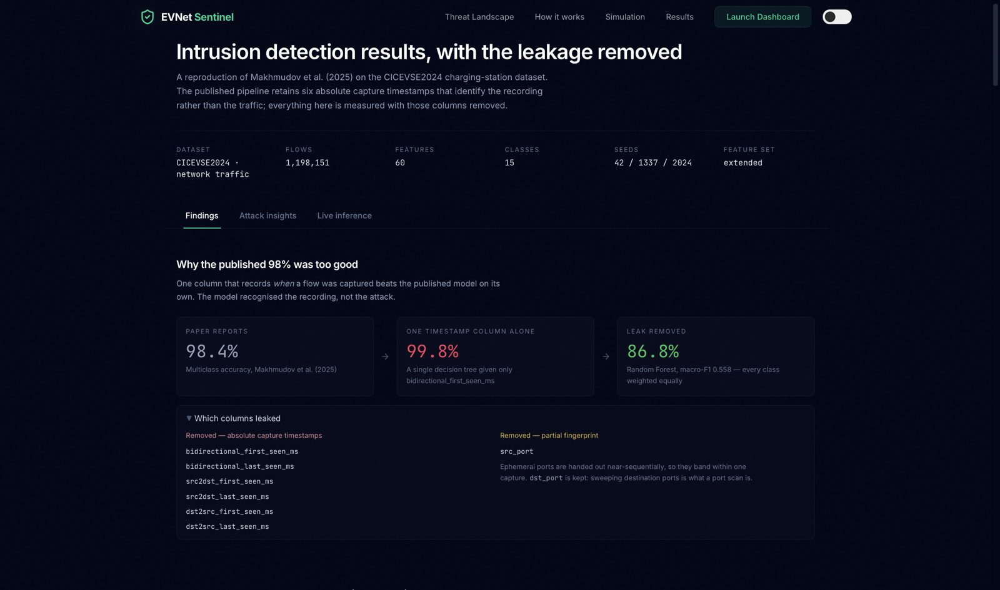
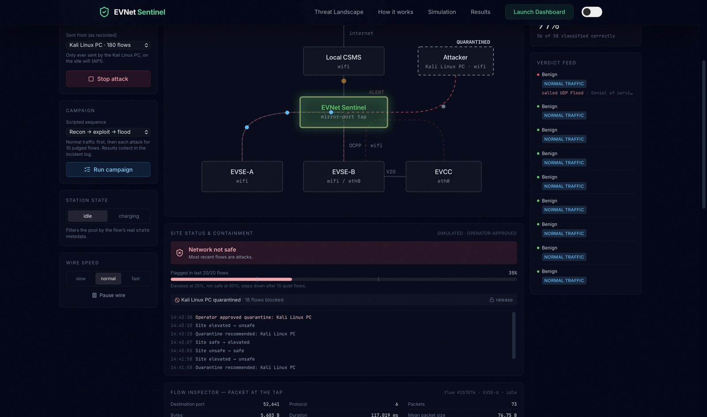
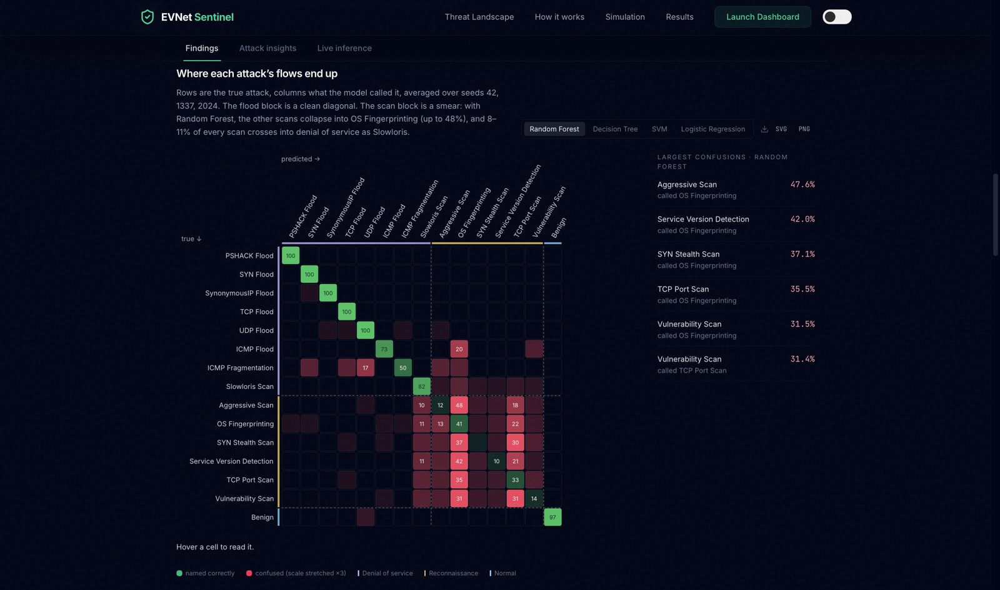
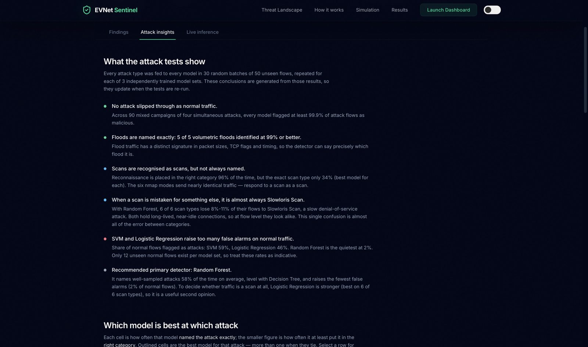
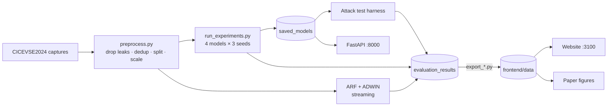

<div align="center">
  

  <p><b>We audited a published 98.4% intrusion detector for EV charging stations, found it was reading timestamps,<br/>and rebuilt it honestly: leak-free benchmarks, per-attack testing, and a working web system.</b></p>

  <p>
    
    
    
    
  </p>
  <p>
    
    
    
    
    
    
  </p>

  <p>
    <a href="#quick-start"><b>Quick start</b></a> ·
    <a href="#what-we-found"><b>What we found</b></a> ·
    <a href="#see-it"><b>Screenshots</b></a> ·
    <a href="#results"><b>Results</b></a> ·
    <a href="#documentation"><b>Docs</b></a> ·
    <a href="#team"><b>Team</b></a>
  </p>
</div>

---

## 🧭 In one minute

| | |
|---|---|
| ❓ **The question** | Makhmudov et al. (2025) report **98.4%** accuracy for an online detector (Adaptive Random Forest + ADWIN) on CICEVSE2024. Does that number measure attack detection? |
| 🔍 **The answer** | Mostly not. **One timestamp column alone scores 99.76%**, because each attack was recorded in its own file at its own time. |
| ✅ **The honest number** | With the leaks removed: **macro-F1 0.558 ± 0.008** (Random Forest, 3 seeds). Floods are near-perfect; network scans are not. |
| 🛠️ **What we built** | A per-attack test harness, a prediction API, simulated containment, and a website that shows every result live. |

<a id="what-we-found"></a>

## 🔍 What we found

<table>
<tr>
<td width="50%" valign="top">

**1 · Timestamp leak**<br/>
`bidirectional_first_seen_ms` alone recovers the 15-class label with **0.9976** accuracy, above the published 0.9840.

**2 · The useful feature was dropped**<br/>
The published pipeline removes `dst_port`, the feature that *defines* a port scan, and keeps the timestamps.

**3 · Stream order inflates accuracy**<br/>
In capture order the label changes only 54 times in 1.92M flows. "Repeat the last label" scores **0.99997**; shuffled, ARF drops to **0.5585**.

</td>
<td width="50%" valign="top">

**4 · Drift alarms are file seams**<br/>
**42 of 43** ADWIN alarms fall within 100 flows of a join between capture files (p < 0.0005).

**5 · `src_port` is a fingerprint**<br/>
Ephemeral ports band per capture; removing it costs the Decision Tree twice what it costs Random Forest.

**➜ After correction**<br/>
Floods: **F1 ≥ 0.999**. The six nmap scans: **0.10 to 0.27**. Mutual information shows the best feature explains **98%** of DoS type but only **5%** of scan type: the limit is in the data.

</td>
</tr>
</table>

<a id="see-it"></a>

## 🖼️ See it

<table>
<tr>
<td width="50%"><br/><sub><b>Dashboard</b>: the leak in three numbers</sub></td>
<td width="50%"><br/><sub><b>Simulation</b>: site goes "not safe", attacker quarantined</sub></td>
</tr>
<tr>
<td width="50%"><br/><sub><b>Confusion explorer</b>: floods on the diagonal, scans smeared</sub></td>
<td width="50%"><br/><sub><b>Attack insights</b>: what an operator should take away</sub></td>
</tr>
</table>

<a id="quick-start"></a>

## ⚡ Quick start

```bash
make setup && (cd frontend && npm install)   # once

make web        # 🌐 website   → http://localhost:3100
make api        # ⚙️  API       → http://localhost:8000   (needs locally trained models)
make diagrams   # 🗺️  diagrams  → http://localhost:8765
make test       # 🧪 71 tests
```

| Page | Try this |
|---|---|
| **`/`** | Drag an attack onto a charging station in *Beat the Sentinel*; move the slider in *Tune the detector*; scroll the testbed story |
| **`/simulation`** | Launch a SYN flood, watch the site turn **Network not safe**, then approve the quarantine |
| **`/dashboard`** | *Findings* (the evidence) · *Attack insights* (per-attack results and response guidance) · *Live inference* |
| **`/docs`** | Method at a glance and the architecture |

More detail, stopping servers, and sharing a public link with ngrok: **[docs/RUNNING.md](./docs/RUNNING.md)**.

## ✨ Features

| | Feature | What it does |
|---|---|---|
| 🔍 | **Leakage audit** | Five findings, each reproduced by its own script in `src/reproduction/` |
| 📊 | **Corrected benchmarks** | 6 static models (incl. XGBoost, LightGBM) + ARF/ADWIN, 15 classes, 3 seeds, macro-F1 |
| 🎯 | **Attack test harness** | Every attack × every model: detected / right category / named exactly, with regression gates |
| 🛡️ | **Simulated containment** | Threat level Safe → Elevated → Not safe; operator-approved quarantine of the attacking device only |
| 🌐 | **Web front end** | Landing page, simulation console, dashboard, all built from exported results |
| ⚙️ | **Prediction API** | `POST /predict` classifies one flow with any corrected model |

## 🏗️ How it fits together



> The website reads the exported JSON and never calls the API, so it runs on a fresh clone with no dataset. Animated, source-linked versions of this diagram are in [`docs/diagrams/`](./docs/diagrams/).

<a id="results"></a>

## 📈 Results

| Model | Macro-F1 (3 seeds) | Accuracy | False alarms | |
|---|---|---|---|---|
| **Random Forest** | **0.558 ± 0.008** | 0.868 | 3% | highest macro-F1; trains in 8.5 s |
| Decision Tree | 0.557 ± 0.010 | 0.868 | 11% | |
| 🥇 **XGBoost** | 0.551 ± 0.011 | 0.869 | **2%** | recommended detector (fewest false alarms; tied with RF) |
| LightGBM | 0.550 ± 0.004 | 0.868 | 3% | |
| Logistic Regression | 0.436 ± 0.017 | 0.863 | 44% | best second opinion on scans |
| SVM | 0.411 ± 0.017 | 0.862 | 58% | |

The four tree models are statistically tied: gradient boosting does not break the scan ceiling. Every model reaches about 0.86 accuracy, which is why macro-F1 is the headline. The recommended detector is chosen by a fixed rule: among models that name attacks within 2 points of the best, the fewest false alarms. Sources: [`MULTISEED_RESULTS.md`](./evaluation_results/multiseed/MULTISEED_RESULTS.md) · [`BOOSTING_RESULTS.md`](./evaluation_results/boosting/BOOSTING_RESULTS.md) · [`attack_tests.json`](./evaluation_results/attack_tests.json) · [guide to the results folder](./evaluation_results/README.md).

> [!WARNING]
> `evaluation_results/rf_evaluation_summary.md` and `SVM_evaluation_summary.md` predate the correction (their 0.9994 came from the timestamps). They are kept only as the "before".

<a id="documentation"></a>

## 📚 Documentation

| | Topic | Read |
|---|---|---|
| 📄 | **Research paper** | [v3 · 7 pages](./docs/research%20paper/EVNet_Sentinel_Research_Paper_v3.pdf) · [v2 · full](./docs/research%20paper/EVNet_Sentinel_Research_Paper_v2.pdf) · [walkthrough](./docs/PAPER_WALKTHROUGH.md) |
| ▶️ | **Running the project** | [RUNNING.md](./docs/RUNNING.md) · [Runbook PDF](./docs/EVNet_Sentinel_Runbook.pdf) |
| 🔍 | **Leakage audit** | [Results](./docs/leakage_audit_results.md) · [Findings PDF](./docs/EVNet_Sentinel_Findings.pdf) |
| 🎤 | **Demo scripts** | [General](./docs/DEMO_SCRIPT.md) · [Data Warehousing & Mining](./docs/DEMO_DWM.md) |
| 🧭 | **Walkthroughs** | [Website](./docs/WEBSITE_WALKTHROUGH.md) · [Notebooks](./docs/NOTEBOOK_WALKTHROUGH.md) |
| 🏛️ | **Design** | [Architecture](./docs/ARCHITECTURE.md) · [Use cases](./docs/evnet_sentinel_use_cases.md) · [SRS](./docs/Project_SRS/WDL_SRS_EVNetSentinel.pdf) |
| 🧪 | **Data** | [Feature engineering](./docs/dataset_feature_engineering.md) · [Resampling trade-offs](./docs/Resampling_Tradeoffs.md) · [Reference papers](./docs/papers.md) |

<details>
<summary><b>📁 Repository layout</b></summary>

| Path | Contents |
|---|---|
| `src/data_prep/` | `preprocess.py`, the corrected (leak-free) pipeline |
| `src/models/` | Training scripts and notebooks per model |
| `src/evaluation/` | Multi-seed experiments, attack harness, exporters |
| `src/reproduction/` | One script per leakage finding, plus attack routes |
| `src/response/` | Containment policy (threat level, quarantine) |
| `src/api/` | FastAPI prediction service |
| `frontend/` | Next.js website; `frontend/data/` is what it displays |
| `evaluation_results/` | Every reported number, labelled current / evidence / historical |
| `tests/` | pytest suite (71 tests) |
| `docs/` | Papers, figures, diagrams, guides |
| `data/` · `saved_models/` · `datasets/` | Local only, never committed |

Notebooks (single seed, saved with outputs): [Random Forest](./src/models/random_forest/Random_Forest_Training.ipynb) · [Decision Tree](./src/models/decision_tree/Decision_Tree_Training.ipynb) · [Logistic Regression](./src/models/log_reg/Logistic_Regression_Training.ipynb) · [SVM](./src/models/svm/svm_training.ipynb) · [XGBoost](./src/models/xgboost/XGBoost_Training.ipynb) · [LightGBM](./src/models/lightgbm/LightGBM_Training.ipynb) · [ARF + ADWIN](./src/models/arfadwin/ARF_ADWIN_Training.ipynb)

</details>

<details>
<summary><b>🔐 Dataset access rules</b></summary>

The CICEVSE2024 dataset used for this project is heavy and access-restricted. Please follow these rules:
1. **Never commit the dataset**: All dataset archives and CSV files (`*.tar.xz`, `*.zip`, `*.csv`) are strictly ignored in `.gitignore`. Do NOT bypass this rule.
2. **Secure the URL**: The Google Drive URL for the dataset must never be hardcoded in the codebase or public documentation. 
3. **Local Setup & Data Retrieval**: 
   - Copy `.env.example` to `.env` in the root directory.
   - Add the Google Drive URL (provided by the team admin) to your `.env` file under `CICEVSE2024_DATASET_URL`.
   - Run the automated setup and data pipeline:
     ```bash
     make setup
     make data
     ```
   - *Note: `make data` will download the 2.4GB dataset, extract it to `data/raw/`, and process it into `data/processed/`. Ensure you have sufficient disk space.*

</details>

<details>
<summary><b>🙏 Acknowledgements</b></summary>

This project builds upon the foundational research and methodology open-sourced by the TATU-hacker team. We would like to acknowledge and cite their repository:
- [TATU-hacker/Intrusion_Detection_on_Electric_Vehicle_Charging_Systems](https://github.com/TATU-hacker/Intrusion_Detection_on_Electric_Vehicle_Charging_Systems)

Their work on online machine learning for EVCS intrusion detection heavily inspired our approach, particularly our implementation of the ARF-ADWIN model and the use of the CICEVSE2024 dataset.

</details>

<a id="team"></a>

## 👥 Team

Guide: **Prof. Mahesh Khandke**, Dept. of Computer Engineering, Vidyalankar Institute of Technology, Mumbai.


| Roll No. | Name | Role | GitHub |
|----------|------|---------------------|--------|
| **24102A0013** | Mukta Varak | Cloud Deployment DevOps | [@Mukta01](https://github.com/Mukta01) |
| **24102A0018** | Shruti Chaurasiya | Data Viz & Testing | [@shrutich-30](https://github.com/shrutich-30) |
| **24102A0021** | Shardul Chogale | ML Pipelining & Evaluation | [@shard-c6](https://github.com/shard-c6) |
| **24102A0022** | Neha Chavhan | Frontend & API Integration | [@nehachavhan2006](https://github.com/nehachavhan2006) |

---
<div align="center">
  <i>Created for Software Engineering academic requirements.</i>
</div>
